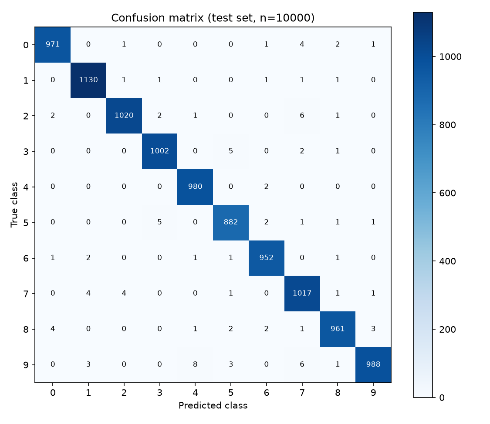
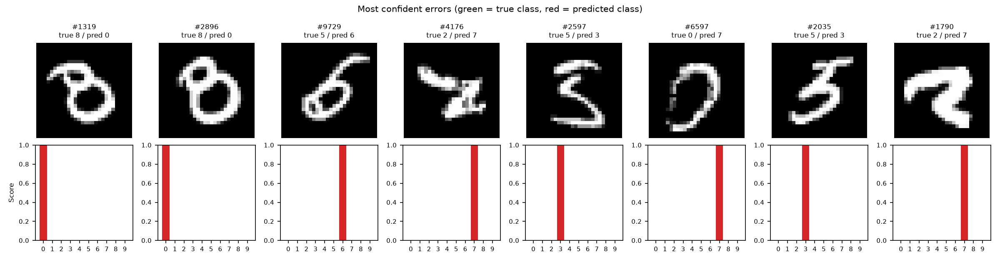

# Technical Evaluation Report: Handwritten Digit Recogniser (CNN)

## 1. Experimental setup

The data is MNIST: 54,000 training images, 6,000 validation images, and 10,000 test images. The validation split is stratified with seed 42, and pixels are divided by 255 to produce float32 values in `[0, 1]`; the channel axis creates `(28, 28, 1)` inputs. The CNN has Conv2D(32, 3x3), MaxPooling2D(2x2), Conv2D(64, 3x3), MaxPooling2D(2x2), Flatten, Dense(128, ReLU), and Dense(10, softmax). It has 225,034 parameters. Training uses sparse categorical cross-entropy, Adam at learning rate 0.001, batch size 128, and 15 epochs; the checkpoint with the lowest validation loss is selected (epoch 5 for seed 42).

The baseline model was frozen at `git_commit_at_freeze` `2ba1953e6b3fd3ddfa57b54857a6f91aa8b70136` in `frozen_config.json`, and SHA-256 `f5d262d844813d17b1c5f2bd5924e38a998a1bf3384ec105f8e7ec5030e70e6e` was recorded for `models/cnn_baseline_best.keras`. The repository tag `model-frozen` points to the freeze commit. The test set was declared unused before freezing. The environment is Windows/Python 3.14.4; TensorFlow 2.22.0-rc0 and Keras 3.16.0.dev2026102704, with NumPy 2.5.4 and scikit-learn 1.9.1.

## 2. Final test results

The frozen baseline made 97 errors on 10,000 test images, giving 99.03% accuracy. The approximate 95% interval is 98.838%-99.222% (0.9903 plus or minus 0.001921), and test loss is 0.030765. Validation accuracy was 98.65% and validation loss was 0.048649. The test accuracy is 0.38 percentage points higher and test loss is lower, so the test set does not indicate deterioration. This comparison is only descriptive: the validation set was used for epoch and checkpoint selection, while the test set was held out for a one-time estimate. Sampling variability and the held-out-data result, not a direct causal comparison, remain the interpretation.

| Class | Precision | Recall | F1 | Support |
|---:|---:|---:|---:|---:|
| 0 | 0.9928 | 0.9908 | 0.9918 | 980 |
| 1 | 0.9921 | 0.9956 | 0.9938 | 1135 |
| 2 | 0.9942 | 0.9884 | 0.9913 | 1032 |
| 3 | 0.9921 | 0.9921 | 0.9921 | 1010 |
| 4 | 0.9889 | 0.9980 | 0.9934 | 982 |
| 5 | 0.9866 | 0.9888 | 0.9877 | 892 |
| 6 | 0.9917 | 0.9937 | 0.9927 | 958 |
| 7 | 0.9798 | 0.9893 | 0.9845 | 1028 |
| 8 | 0.9907 | 0.9867 | 0.9887 | 974 |
| 9 | 0.9940 | 0.9792 | 0.9865 | 1009 |
| Macro | 0.9903 | 0.9902 | 0.9903 | 10000 |
| Weighted | 0.9903 | 0.9903 | 0.9903 | 10000 |

Digit 9 has the lowest recall (97.92%), while digit 7 has the lowest precision (97.98%). Thus, 9 is the main class-wise recall weakness, but a separate minority of digit-7 predictions is also the least precise.

## 3. Confusion matrix

The matrix uses true class on rows and predicted class on columns. The three largest off-diagonal cells are 9→4 (8 errors), 2→7 (6), and 9→7 (6). They are not symmetric: 4→9 has 0, 7→2 has 4, and 7→9 has 1 in this test matrix. The 9→4 and 9→7 confusions are therefore concentrated directions rather than paired, reciprocal mistakes.

## 4. Failure analysis

All 97 test errors were manually annotated by one annotator. The categories are unusual shape (35), ambiguous stroke (31), thin or faint (10), slanted or rotated (9), broken or cut off (6), questionable label (4), and other (2). These counts are subjective and would not have a unique ground truth if re-annotated.

**Observed / supposed pattern: unusual shapes.** I observed 35 errors with looped, extra, thick, or otherwise atypical strokes. I suppose these examples are underrepresented relative to the model's learned canonical MNIST shapes, but this is a hypothesis rather than evidence from a separate distribution.

**Observed / supposed pattern: ambiguous strokes.** I observed 31 examples where 3/5, 7/1, 8/9, or 9/4 distinctions depended on stroke details. I suppose local visual similarity and missing long-range context caused several of these confusions; a human would also need to decide in some borderline cases.

**Observed / supposed pattern: thin, faint, broken, and slanted strokes.** I observed 25 errors across thin/faint (10), broken/cut-off (6), and slanted/rotated (9). I suppose stroke loss or positioning moved these outside the training distribution. The observed pattern is stronger than the mechanism because the annotations do not establish a causal origin.

The model had 32 errors with predicted score at least 0.90 and 9 at least 0.99. Four examples illustrate the issue: test index 1319 was 8→0 at 0.9996, 2896 was 8→0 at 0.9994, 947 was 8→9 at 0.9890, and 9729 was 5→6 at 0.9983. A model score is a ranking/calibration output, not a guarantee; these values describe output confidence, while correctness is determined independently by the MNIST label.

## 5. Robustness and generalisation

The robustness tests were exploratory validation-set transformations defined before execution, not independent benchmarks. I used rotation, scale, vertical shift, blur, noise, contrast, and inversion. The augmented model is compared here only for context.

| Case | Baseline validation accuracy | Augmented validation accuracy |
|---|---:|---:|
| Original | 98.650% | 98.983% |
| Blur, sigma 1.5 | 92.750% | 97.300% |
| Vertical shift, ±4 px | 49.583 / 48.867% | 95.533 / 94.417% |
| Noise, standard deviation 0.4 | 85.717% | 46.917% |
| Scale factor 0.6 | 63.683% | 85.533% |
| Inversion | 27.317% | 21.683% |

The baseline was weakest under 4-pixel vertical shifts (about 49%) and inversion (27.32%). Its strongest mild perturbations were contrast 0.6 (98.65%, unchanged) and blur sigma 0.5 (98.55%). Augmentation clearly improved shift, rotation, blur, scale, and normal noise, but made high-noise and inversion worse; the latter is not handled because white-on-black MNIST inversion was outside training.

Blank input was predicted as digit 1 with score 0.1455, all-white input as 0 with 0.7111, and uniform noise was mostly assigned to 8. The app should therefore reject, request confirmation for, or route low-confidence/non-digit input rather than treating the predicted class as a valid digit. The softmax score is especially unsuitable as an out-of-distribution detector; a white input received high confidence even though it is not a digit.

At the baseline's selected epoch, training accuracy was 99.385% versus validation accuracy 98.65%, a gap of 0.735 percentage points. Training loss at that checkpoint was about 0.0219 versus validation loss 0.04865. Training loss continued to fall later, while validation loss rose after the selected epoch, indicating overfitting in later epochs rather than a final held-out test failure. Across four seed runs, CNN validation accuracy ranges from 98.650% to 98.833% (mean 98.742%, sample SD 0.0967 percentage points). Sampling variability is large enough that small differences should not be treated as guaranteed.

## 6. Improvement experiment

The candidate was on-the-fly augmentation: `RandomRotation(0.04)`, `RandomTranslation(0.1, 0.1)`, and `RandomZoom(0.1)`, in training only. The pre-registered rule was to adopt only if both mean four-seed validation accuracy was higher and mean validation loss was lower. Baseline mean accuracy was 98.742% versus 99.021% for augmentation, and mean loss was 0.045987 versus 0.033684. The augmented accuracy range was 98.983%-99.100%; it did not overlap the baseline range of 98.650%-98.833%. The rule was therefore met and augmentation was adopted.

The adopted seed-42 augmented model had 81 test errors and 99.19% accuracy (95% interval 99.014%-99.366%) on the 10,000 test images, versus 97 errors and 99.03% for the original. Test loss improved from 0.030765 to 0.026569. This separate test result is consistent with the validation gain, although it is not proof of real-world robustness.

## 7. Limitations

This result is MNIST-only and may not generalize to pen strokes, camera captures, or app-specific backgrounds. Error annotation is from one subjective annotator and four seeds are limited evidence for sampling variability. Test errors informed later proposal and interpretation work, so proposals were not independent of the final test; robustness is exploratory rather than an independent benchmark. Training and latency measurements are from one CPU, and exact wall-clock times can vary with machine load.

## 8. Prioritised improvements

1. **Add training augmentation and digit rejection logic.** Benefit: the adopted augmentation improves validation and held-out test accuracy and vertical/scale robustness. Cost: longer training and more preprocessing/rejection UI work. Failure mode: severe extreme transformations or inversion may remain poor, and rejecting low-confidence input can create false negatives for valid handwriting.
2. **Improve class-9 discrimination.** Benefit: addressing the lowest recall class should reduce the 9→4 and 9→7 error clusters. Cost: targeted augmentation, hard-example mining, or calibration requires additional experiments and risk of regressions in 4/7. Failure mode: a targeted fix may improve 9 recall but reduce precision for visually similar digits.
3. **Add out-of-distribution and calibration checks.** Benefit: blank, white, and noise probes show that top softmax score alone is not sufficient. Cost: requires a separate OOD dataset or conservative confidence/area rules and app changes. Failure mode: over-strict thresholds could reject valid MNIST-like digits, while weak thresholds would leave false predictions.

## 9. Reproducibility

Run commands from the repository root:

- `python -m src.train_cnn --run-id cnn_baseline`
- `python -m src.freeze_model --run-id cnn_baseline`
- `python -m src.evaluate`
- `python -m src.error_analysis`
- `python -m src.summarise_annotations`
- `python -m src.robustness --model models/cnn_baseline_best.keras --out results/week7_robustness`
- `python -m src.compare_improvement`
- `python -m src.evaluate --out results/week7_improved` for the explicitly frozen augmented model evaluation

The freeze tags are `model-frozen` and `model-aug-frozen`, with week tags `week7-partA` and `week7-partB`. Scripts are under `src/`; baseline and augmented test artifacts are under `results/week7/` and `results/week7_improved/`, respectively. The confusion matrix, gallery, annotation summary, robustness JSON/plots, frozen configuration, and improvement decision are preserved in their directories.

## Answers to the review questions

**1. Can a high-accuracy model still fail systematically on one digit?** Yes. It reached 99.03% test accuracy, yet digit 9 had the lowest recall, 97.92%, and its largest confusion was 9→4 (8 errors). An aggregate accuracy of 99.03% therefore hides a concentrated class-level weakness.

**2. What is the difference between a validation result and a test result?** Validation accuracy was 98.65% and test accuracy was 99.03%. Validation was repeatedly used to choose epochs and model candidates, so it can be optimistic or influence decisions; the test set was held out until after freezing and gives the once-only held-out estimate.

**3. Why does a confident prediction not guarantee correctness?** The model gives a relative softmax score, not a correctness guarantee. It produced 32 errors at predicted score at least 0.90, including 9 at least 0.99; examples include 8→0 with 0.9996 and 8→0 with 0.9994, so high confidence can coexist with the wrong MNIST label.

**4. What evidence would support a claim of improved robustness?** Evidence should include a pre-defined independent robustness set or held-out test distribution, paired or four-seed validation results with accuracy/loss ranges, and improvement across multiple perturbation families rather than one convenient case. It would also require preserved weak-case performance and, ideally, app-style blank/noise/OOD testing showing fewer confident false digits.
